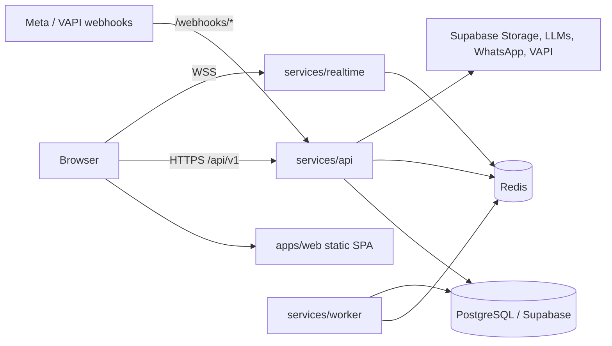

# Bitlance Ground OS — Deployment Guide

> **Status of this document.** Written by inspecting the repository. Local-development
> commands and the build were run locally (`npm install`, `npm run db:generate`,
> `npm run build`, `npm run dev`). **No production deployment has been performed or tested.**
> Items that cannot be determined from the repo are marked `TODO`.
> Findings that affect production readiness are called out as **⚠ Known issue**.

---

## 1. Overview

Bitlance Ground OS is an AI-powered field-sales and developer-intelligence platform
(live agent tracking, meetings/visits, WhatsApp, voice, AI reports, workflows).

It is an **npm-workspaces + Turborepo monorepo** (`package.json`, `turbo.json`) with
multiple independently-run processes:

| Component | Path | Tech | Default port | Responsibility |
| --- | --- | --- | --- | --- |
| Web dashboard | `apps/web` | React + Vite (static SPA) | 5173 (dev) | UI; calls API and WebSocket gateway |
| API | `services/api` | Node, Express, Prisma, JWT | `API_PORT` (4000) | REST API under `/api/v1/*`, webhooks under `/webhooks/*`, `/health` |
| Realtime gateway | `services/realtime` | Node, `ws`, Redis pub/sub | `REALTIME_PORT` (4001) | WebSocket server for live telemetry; authenticates with `JWT_SECRET` |
| Worker | `services/worker` | Node, BullMQ | none | Background queues: AI transcription/analysis, WhatsApp, voice, creatives, notifications, workflows, analytics |
| Database package | `packages/database` | Prisma 5 (PostgreSQL) | – | Schema + shared Prisma client |
| Types / UI | `packages/types`, `packages/ui` | TypeScript | – | Shared code |

**External dependencies**

- **PostgreSQL** — Supabase-hosted (README: "currently configured with Supabase").
- **Redis** — required by API (event bus), Worker (BullMQ) and Realtime (pub/sub).
- **Supabase Storage** — media bucket (`STORAGE_PROVIDER=supabase`).
- Optional providers (selected by env): Gemini / OpenAI (LLM), Deepgram (STT),
  Meta WhatsApp Cloud API, VAPI (voice), Google Maps (frontend map key).



**Hosting providers:** the repository contains **no** hosting configuration
(no Dockerfile for the apps, `vercel.json`, `netlify.toml`, `render.yaml`, `fly.toml`,
`Procfile`, etc.). Provider choice is `TODO`; Section 5 is therefore provider-neutral.

---

## 2. Prerequisites

- **Node.js ≥ 20** and **npm ≥ 10** (`package.json` → `engines`; `packageManager: npm@10.8.2`).
  Local build was verified on Node 24 / npm 11.
- **PostgreSQL** reachable from API, Worker and migration host (Supabase project or any Postgres).
- **Redis** reachable from API, Worker and Realtime.
  `docker-compose.yml` provides `redis:7-alpine` (and a local Postgres) for local use only; Docker is optional —
  any Redis ≥ 6 works (it can also be compiled from source or hosted).
- A host that can run **three long-lived Node processes** (API, Realtime, Worker) and
  serve a **static site** (web). The Realtime gateway needs WebSocket support.
- Accounts/keys only for the integrations you enable (Section 3).
- Permissions: ability to set environment variables/secrets on the host, run a migration/schema command
  against the production DB, and configure DNS/TLS.

---

## 3. Environment Configuration

Variables were collected by grepping `process.env.*` / `import.meta.env.*` across
`apps`, `services`, `packages`, plus `services/api/src/config/env.ts` and `prisma/schema.prisma`.
A safe template exists at [`.env.example`](./.env.example) (note: it is **incomplete** — see below).
`.env` is git-ignored. **Never commit real values.**

### 3.1 Core (required)

| Variable | Used by | Description / where to get it |
| --- | --- | --- |
| `DATABASE_URL` | Prisma (all services) | Postgres connection string. Supabase: Project Settings → Database → Connection string. URL-encode special characters in the password. |
| `DIRECT_URL` | Prisma CLI | **Required by `schema.prisma`** (`directUrl = env("DIRECT_URL")`); Prisma fails validation without it. Use the direct (non-pooled) connection; may equal `DATABASE_URL`. *Missing from `.env.example`.* |
| `JWT_SECRET` | API, Realtime | Access-token signing secret. Generate: `openssl rand -base64 48`. Must be identical for API and Realtime. |
| `JWT_REFRESH_SECRET` | API | Refresh-token secret; different random value. |
| `REDIS_HOST`, `REDIS_PORT` | API, Worker, Realtime | **These are what the code actually reads.** Defaults `127.0.0.1` / `6379`. |
| `NODE_ENV` | all | `production` in production. |

> **⚠ Known issue:** `REDIS_URL` appears in `.env.example` and `env.ts` but the services
> connect using `REDIS_HOST`/`REDIS_PORT` only. Redis with **password or TLS is not supported** by the current
> connection code (no `password`/`tls` option is passed). Managed Redis requiring auth/TLS needs a code
> change (TODO) or a private/unauthenticated Redis on a private network.

### 3.2 Ports and networking

| Variable | Used by | Default |
| --- | --- | --- |
| `API_PORT` | API | `4000` |
| `REALTIME_PORT` | Realtime | `4001` |
| `CORS_ORIGINS` | API | Comma-separated allowed origins. Default is `http://localhost:5173,http://localhost:5174`. **Must be set to the production web origin.** |
| `LOG_LEVEL` | API logger | Optional |

### 3.3 Storage / Supabase

| Variable | Description |
| --- | --- |
| `STORAGE_PROVIDER` | `supabase` or `mock` (default `mock` if unset) |
| `STORAGE_BUCKET` | Default `ground-os-media`; bucket must exist in Supabase Storage |
| `SUPABASE_URL` | Project URL (Settings → API). Code has a hardcoded fallback project URL — always set explicitly. |
| `SUPABASE_SECRET_KEY` | Server-side secret key. **Server only.** |
| `SUPABASE_PUBLISHABLE_KEY`, `SUPABASE_JWKS_URL` | Declared (optional) in `env.ts` |

### 3.4 AI / integrations (optional — mock/fallback if unset)

| Variable | Description |
| --- | --- |
| `LLM_PROVIDER` | `mock` \| `gemini` \| `openai` \| `auto` (default `auto`) |
| `GEMINI_API_KEY`, `OPENAI_API_KEY` | LLM keys (API and Worker) |
| `STT_PROVIDER`, `DEEPGRAM_API_KEY` | Speech-to-text (`deepgram` or `mock`) |
| `WHATSAPP_PROVIDER` (`meta`/`mock`), `WHATSAPP_ACCESS_TOKEN`, `WHATSAPP_PHONE_NUMBER_ID`, `WHATSAPP_WABA_ID`, `WHATSAPP_VERIFY_TOKEN` | Meta WhatsApp Cloud API. `WHATSAPP_VERIFY_TOKEN` must match the token configured in the Meta webhook settings. |
| `VOICE_PROVIDER` (`vapi`/`mock`), `VAPI_API_KEY`, `VAPI_PHONE_NUMBER_ID`, `VAPI_ASSISTANT_ID` | Voice AI |

### 3.5 Frontend (build-time — baked into the bundle)

| Variable | Description |
| --- | --- |
| `VITE_API_URL` | Public API base URL (default `http://localhost:4000`) |
| `VITE_WS_URL` | Public WebSocket URL, `wss://…` in production (default `ws://localhost:4001`) |
| `VITE_MAPS_API_KEY` | Map key (also `VITE_CARTO_API_KEY` fallback). Restrict by HTTP referrer. |
| `VITE_OPENAI_API_KEY` | Read by `apps/web/src/lib/meeting-evaluator.ts`. **Anything `VITE_*` is public** — do not set a real OpenAI key here (see Section 10). |

`vite.config.ts` reads `.env` from the repo root (`envDir: ../../`). The dev-only `/api` and `/ws` proxy
in `vite.config.ts` does **not** exist in a static production build, so `VITE_API_URL`/`VITE_WS_URL` must be correct at build time.

### 3.6 Env-loading caveat

- API: `tsx watch --env-file=../../.env` (dev) and `dotenv` in `server.ts` load the root `.env`.
- Worker and Realtime do **not** call `dotenv` and have no `--env-file`; locally they only see variables present in the
  process environment (so provider keys in `.env` are not picked up by the Worker in `npm run dev`).
  In production, inject variables via the host's environment for **each** process.
- Prisma CLI looks for `.env` in `packages/database` (or the schema dir) — local runs worked with a copy there; in CI/production
  export `DATABASE_URL`/`DIRECT_URL` in the shell instead of relying on files. Do not keep duplicate `.env` files in both
  `packages/database` and `packages/database/prisma` (Prisma errors on conflicts).

---

## 4. Local Setup

```bash
git clone https://github.com/codexuttam/ground-agent-.git
cd ground-agent-/bitlance-ground-os

npm install
cp .env.example .env          # then add DIRECT_URL and real values (see Section 3)
```

Supporting services (choose one):

```bash
docker compose up -d redis            # Redis only
# or: docker compose up -d            # also starts a local Postgres (groundos/groundos@localhost:5432/groundos_dev)
```
Or run any local Redis on `localhost:6379`.

Database:

```bash
npm run db:generate     # prisma generate
npm run db:migrate      # prisma migrate dev  (DEV ONLY)
npm run db:seed         # ts-node --esm src/seed.ts — creates demo org/users
```

> **⚠ Known issue:** `packages/database/prisma/` contains only `schema.prisma` — **there is no `migrations/` directory**
> committed. `prisma migrate dev` against an empty DB would generate a new migration; `prisma migrate deploy` would apply nothing.
> See Section 5.3.

Run:

```bash
npm run dev           # turbo: web + api + worker + realtime (all workspaces with a "dev" script)
npm run dev:web       # http://localhost:5173
npm run dev:api       # http://localhost:4000
npm run dev:worker
```
Realtime has no dedicated root script; it runs under `npm run dev`, or:
`npm run dev --workspace @ground-os/realtime`.

Quality checks: `npm run type-check`, `npm run build`, `npm run lint`
(`lint` is only defined for `apps/web` and requires ESLint config — not verified).

---

## 5. Production Deployment

Deploy in this order: **database → Redis → schema → API → Realtime → Worker → Web → DNS/webhooks.**

### 5.1 Build

From the repo root (verified locally to succeed):

```bash
npm ci
npm run db:generate          # generate Prisma client
npm run build                # turbo: tsc builds for api/worker/realtime; tsc && vite build for web
```
Outputs: `services/*/dist`, `apps/web/dist` (static files).

### 5.2 ⚠ Known issue: compiled services do not start with `npm run start`

`services/api` defines `start: node dist/server.js` (same pattern in worker/realtime), but this was tested and **fails**:

```
Error [ERR_MODULE_NOT_FOUND]: Cannot find module '.../services/api/dist/config/logger'
```
Cause: packages are `"type": "module"` with extension-less relative imports compiled by `tsc` (`moduleResolution: bundler`),
and `@ground-os/database` exports its TypeScript source (`"exports": { ".": "./src/index.ts" }`).
Plain Node cannot run this output.

Options (pick one — **TODO, decision needed**):
1. **Run with `tsx` in production** (the same runner the dev scripts use; `tsx` is a root devDependency, so install with dev dependencies):
   ```bash
   cd services/api      && npx tsx src/server.ts
   cd services/worker   && npx tsx src/index.ts
   cd services/realtime && npx tsx src/index.ts
   ```
   This matches how the services run in development; it has **not** been validated as a production setup.
2. Fix the build (bundle with esbuild/tsup or add `.js` import extensions and build the database package) — a code change outside this document's scope.

Run each as a separate supervised process (systemd, PM2, container, or PaaS service) with `NODE_ENV=production`.

### 5.3 Database provisioning and schema

1. Create the Postgres database (Supabase project or other). Ensure the host running API/Worker can reach it
   (Supabase direct host `db.<ref>.supabase.co` is IPv6-only on some plans; use the pooler/IPv4 add-on if your host lacks IPv6 — verify for your network).
2. Export `DATABASE_URL` and `DIRECT_URL`.
3. Apply the schema. **TODO — decide:** because no migration files are committed:
   - New empty DB: `npx prisma db push --schema packages/database/prisma/schema.prisma` (creates tables from the schema), **or** generate and
     commit a baseline migration first (`npm run db:migrate` in a dev environment) and then use `npm run db:migrate:prod`
     (`prisma migrate deploy`) in production.
   - Existing DB (the Supabase DB currently used for development already contains the tables and a `_prisma_migrations` table): do **not** run
     `migrate dev`/`db:reset` against it.
4. Optional seed: `npm run db:seed`.
   > **⚠** `src/seed.ts` contains hard-coded demo users/passwords (e.g. `admin@123`). Do **not** seed production with them, or change all passwords immediately.

### 5.4 Redis

Provision Redis reachable at `REDIS_HOST:REDIS_PORT` by API, Worker, Realtime (see the auth/TLS limitation in 3.1).
`docker-compose.yml` uses `redis-server --appendonly yes` — enable persistence if queued jobs must survive restarts.

### 5.5 API (`services/api`)

- Start: see 5.2. Listens on `API_PORT` (default 4000).
- Required env: Sections 3.1–3.3; integration vars as needed. Set `CORS_ORIGINS=https://<web-domain>`.
- Health: `GET /health` → `{"status":"ok","service":"ground-os-api",...}`.
- Behind a reverse proxy/TLS terminator. Body limit is 50 MB (`express.json({limit:'50mb'})`) — set the proxy limit accordingly.
- Webhook endpoints (must be publicly reachable over HTTPS):
  - `/webhooks/whatsapp` (GET verify uses `WHATSAPP_VERIFY_TOKEN`; Meta app webhook URL = `https://<api-domain>/webhooks/whatsapp`)
  - `/webhooks/voice` (VAPI server URL)

### 5.6 Realtime gateway (`services/realtime`)

- Listens on `REALTIME_PORT` (default 4001); plain `ws` server with no path and **no HTTP health route** (TCP check only).
- Needs `JWT_SECRET` (same as API) and Redis.
- Expose over **WSS** via the proxy (enable WebSocket upgrade) and set `VITE_WS_URL=wss://<realtime-domain>`.

### 5.7 Worker (`services/worker`)

- No port. Requires Redis, the database, and provider keys (`GEMINI_API_KEY`, `OPENAI_API_KEY`, `DEEPGRAM_API_KEY`, WhatsApp, VAPI as used).
- Run a single instance unless you have reviewed BullMQ concurrency/idempotency of the 8 queues (`ai-transcription`, `ai-analysis`, `whatsapp-outbound`,
  `voice-calls`, `creative-generation`, `notifications`, `workflow-jobs`, `analytics`).
- Handles `SIGTERM`/`SIGINT` gracefully (drains jobs before exit).

### 5.8 Web (`apps/web`)

1. Set build-time vars (`VITE_API_URL=https://<api-domain>`, `VITE_WS_URL=wss://<realtime-domain>`, `VITE_MAPS_API_KEY`).
2. `npm run build --workspace @ground-os/web` → publish `apps/web/dist` to any static host / CDN.
3. It is a single-page app with client-side routing: configure **fallback to `index.html`** for unknown paths.
4. Rebuild and redeploy whenever a `VITE_*` value changes.

### 5.9 Domain, DNS, HTTPS, CORS

- Example layout (TODO: choose real domains): `app.<domain>` → web, `api.<domain>` → API, `ws.<domain>` → Realtime.
- Terminate TLS at the proxy/host; all three public endpoints must be HTTPS/WSS.
- `CORS_ORIGINS` must list exactly the web origin(s) (scheme + host + port, no trailing slash). `credentials: true` is enabled.
- Update Meta (WhatsApp) and VAPI callback URLs to the production API domain.

---

## 6. CI/CD Pipeline

**None is configured.** The repository has no `.github/workflows` or other pipeline files. Deployment is currently manual.

Recommended (not implemented) minimal pipeline: `npm ci` → `npm run type-check` → `npm run build` → deploy web artifact and restart services
→ run schema step (5.3) → smoke tests (Section 7). Store all secrets in the CI/host secret store.

---

## 7. Post-Deployment Verification

```bash
# API liveness
curl -fsS https://<api-domain>/health

# Auth is enforced (expect 401 without token)
curl -i https://<api-domain>/api/v1/agents

# Login (use a real user) and capture accessToken
curl -sS -X POST https://<api-domain>/api/v1/auth/login \
  -H 'Content-Type: application/json' \
  -d '{"email":"<user>","password":"<password>"}'

# Authenticated call
curl -sS https://<api-domain>/api/v1/agents -H "Authorization: Bearer <accessToken>"
```

- **Database:** a successful login proves DB connectivity (it queries `users`). Also check API logs for Prisma errors (P1001 = unreachable, P1000 = bad credentials).
- **Redis:** Worker logs must be free of `ECONNREFUSED`/`[Worker error]`; Realtime logs `✅ Redis connected`.
- **Realtime:** open the dashboard live map and confirm a WebSocket (`wss://…`) connects (browser DevTools → Network → WS).
- **Web:** loads, no CORS errors in the console, API calls go to `VITE_API_URL`.
- **Integrations:** WhatsApp verify (Meta "Verify and save" against `/webhooks/whatsapp`), upload a file to confirm the Supabase bucket, run an AI action with a real provider key.

---

## 8. Monitoring and Troubleshooting

**Logs:** API uses winston + morgan (stdout, request lines included); Worker uses winston (stdout, prefixed `[Worker]`); Realtime logs via `console`.
Use your process manager / host log viewer (`journalctl -u <svc>`, `pm2 logs`, or platform logs). No metrics or error-tracking is configured (TODO).

| Symptom | Likely cause / action |
| --- | --- |
| `connect ECONNREFUSED 127.0.0.1:6379` flooding Worker logs | Redis not running/reachable. Set `REDIS_HOST`/`REDIS_PORT`. |
| Redis `NOAUTH` / TLS errors | Code supports neither (3.1). Use private Redis or change code. |
| Prisma `P1012 Environment variable not found: DIRECT_URL` | Set `DIRECT_URL`. |
| Prisma `P1001 Can't reach database server` | Wrong host, firewall, paused Supabase project, or IPv6-only host unreachable from your network. |
| Prisma `P1000 Authentication failed` | Wrong/rotated DB password; URL-encode special characters. |
| Prisma "conflict between env vars in .env and prisma/.env" | Remove the duplicate `.env`. |
| `ERR_MODULE_NOT_FOUND` on `npm run start` | Known issue 5.2. |
| 401 on every `/api/v1/*` call | Missing/expired Bearer token, or `JWT_SECRET` differs from the one that issued the token. |
| Browser CORS error | `CORS_ORIGINS` doesn't exactly match the web origin. |
| Web calls `localhost` in production | `VITE_API_URL`/`VITE_WS_URL` not set at build time — rebuild. |
| WebSocket fails to connect | Proxy lacks WS upgrade, `ws://` used on an HTTPS page, or `JWT_SECRET` mismatch with the API. |
| WhatsApp webhook verification fails | `WHATSAPP_VERIFY_TOKEN` mismatch, or the API URL isn't public HTTPS. |
| Large uploads fail | Proxy body limit below 50 MB. |

---

## 9. Rollback and Recovery

- **Code:** tag each release (`git tag vX.Y.Z`). To roll back, redeploy the previous tag: rebuild/redeploy API, Realtime, Worker, and re-publish the previous `apps/web/dist`.
  Keep the previous web build artifact for instant revert.
- **Order:** roll back Web first (if the API contract changed), then services; keep Worker stopped while rolling back if jobs might be processed by mismatched code.
- **Database:** take a backup/snapshot **before** any schema change (Supabase: Database → Backups; or `pg_dump "$DIRECT_URL" -Fc -f backup.dump`).
  Restore with `pg_restore`. Prisma has no automatic down-migrations — prefer backward-compatible (additive) changes, and never run
  `db:reset` (`prisma migrate reset --force`) or `migrate dev` against production.
- **Failed schema change:** restore from the backup taken beforehand, then redeploy the previous code version.
- **Redis:** holds queue/pub-sub state only; with persistence off, in-flight jobs are lost on restart.

---

## 10. Security Checklist

- [ ] No secrets in Git. `.env` is git-ignored; use the host's secret manager. **Rotate** any key that was ever pasted into chat, tickets, or screenshots.
- [ ] Set strong, unique `JWT_SECRET` / `JWT_REFRESH_SECRET`. The code falls back to hard-coded development secrets if unset — production must never rely on them.
- [ ] `NODE_ENV=production`.
- [ ] **Do not set `VITE_OPENAI_API_KEY`** (or any secret) for the web build: all `VITE_*` values are shipped to browsers. Move that call server-side (TODO, code change).
- [ ] Restrict `VITE_MAPS_API_KEY` by HTTP referrer/API scope in Google Cloud.
- [ ] `SUPABASE_SECRET_KEY` only on the API/Worker host; never in the web build.
- [ ] HTTPS/WSS everywhere; `CORS_ORIGINS` limited to the real web origin (no wildcards).
- [ ] Database: restrict network access (allow-list host IPs), use a dedicated DB user with least privilege for the app instead of the `postgres` superuser (TODO), enable backups.
- [ ] Redis not exposed to the public internet (no auth/TLS support in current code).
- [ ] Do not run `db:seed` with the built-in demo credentials in production; change/disable demo users.
- [ ] Verify webhook authenticity: `WHATSAPP_VERIFY_TOKEN` set to a random value. The `.env`-style `WHATSAPP_WEBHOOK_SECRET` is **not** read by the code.
- [ ] Run `npm audit` — the dependency install reported 11 vulnerabilities (1 critical) at the time of writing; also `multer@1.x` is flagged deprecated/vulnerable.

---

## Appendix A — Open TODOs

1. Choose hosting provider(s); no deploy config exists in the repo.
2. Fix or decide on the production start strategy (5.2).
3. Add committed Prisma migrations or formally adopt `db push` (5.3); add `DIRECT_URL` to `.env.example`.
4. Redis authentication/TLS support if using managed Redis (3.1); `REDIS_URL` is currently unused.
5. Move OpenAI usage out of the browser (`VITE_OPENAI_API_KEY`).
6. Add Dockerfiles and a CI workflow if containerized deployment/automation is wanted.
7. Add a health route (or TCP check) strategy for Realtime and Worker; add monitoring/error tracking.
8. Provide the list of production domains and Meta/VAPI webhook configuration details.
9. Make Worker/Realtime load environment consistently (they do not read `.env`).
